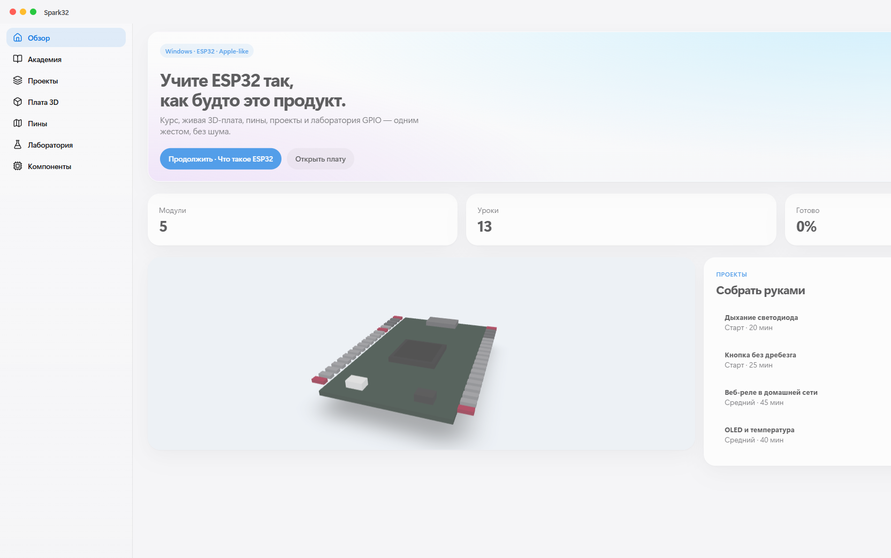
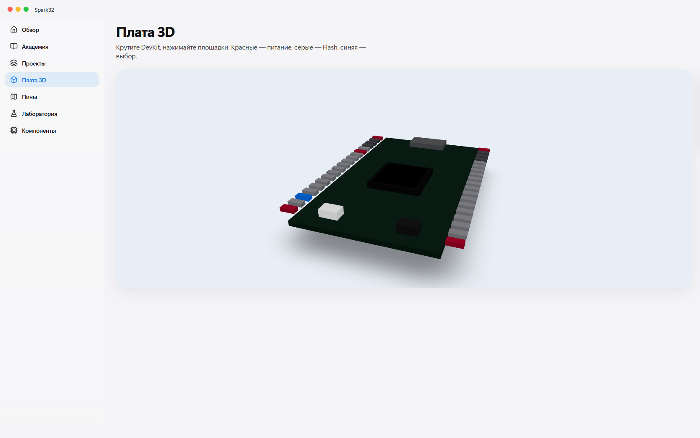

# Spark32

Обучающее Windows-приложение по **ESP32**: курс, проекты, карта пинов и живая 3D-плата DevKit. Интерфейс светлый, спокойный, в духе Apple. Полностью бесплатно и с открытым кодом.

[](LICENSE)
[](#запуск)
[](#что-внутри)

<p align="center">
  
</p>

## Зачем это

ESP32 обычно учат по разрозненным статьям и серым скриншотам Arduino IDE. Spark32 собирает путь в одном окне: теория → проверка → 3D-плата → проект на столе.

## Что внутри

- **Академия** — знакомство с чипом, GPIO / PWM / АЦП, UART I2C SPI, Wi‑Fi и BLE, FreeRTOS и deep sleep. У каждого урока текст, код, сцена и квиз.
- **Проекты** — от дыхания светодиода до MQTT и логгера на батарее, со списком деталей и шагами.
- **Плата 3D** — крутите DevKit, нажимайте площадки, читайте роль пина.
- **Пины и компоненты** — поиск по GPIO, датчикам, OLED, реле.
- **Лаборатория** — виртуальный `digitalWrite` и ШИМ, без железа.

<p align="center">
  
</p>

## Запуск

Нужны Windows, [Node.js 20+](https://nodejs.org/) и Git.

```bash
git clone https://github.com/Mintimer1315/Spark32.git
cd Spark32
npm install
npm run dev
```

Только браузер, без окна Electron:

```bash
npm run dev:web
```

Откроется `http://127.0.0.1:5173/`.

## Стек

Electron · React · Vite · Three.js · TypeScript

Прогресс уроков хранится локально в браузере, никуда не уходит.

## Лицензия

[MIT](LICENSE) — можно форкать, учить, встраивать.
